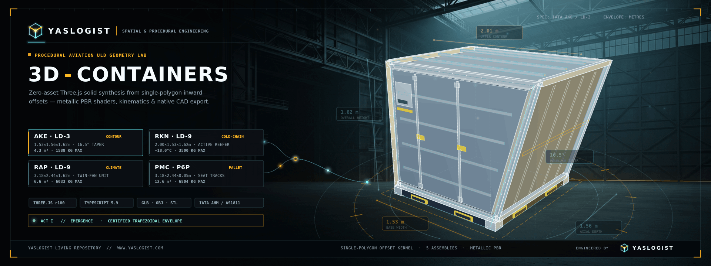
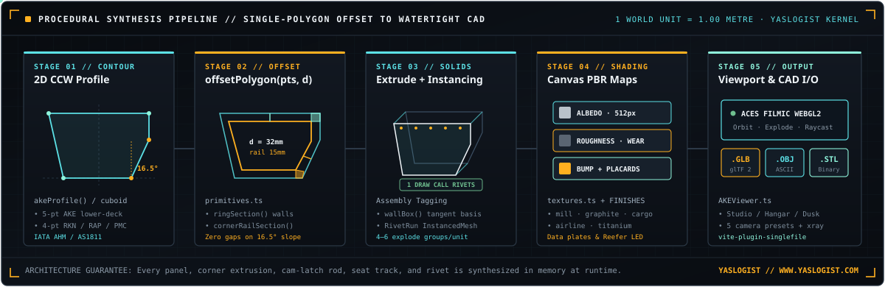
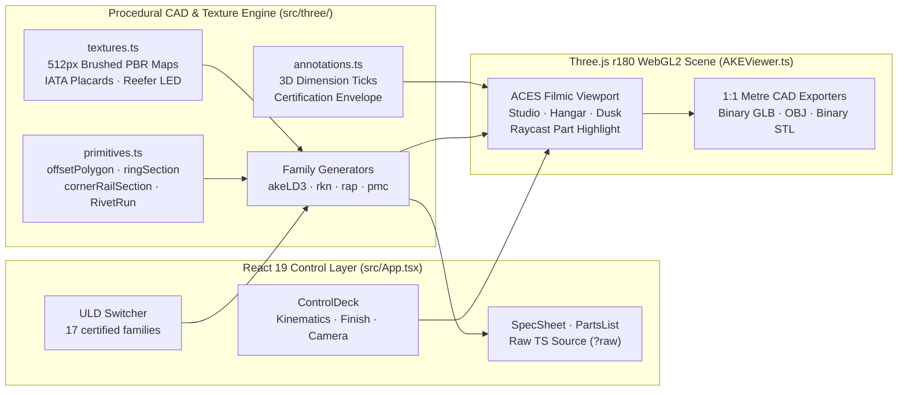

<div align="center">
  <a href="https://www.yaslogist.com">
    
  </a>
  

  <br />

  <p>
    <strong>Browser-native procedural CAD &amp; WebGL2 inspection laboratory for certified aviation Unit Load Devices (ULDs)</strong><br />
    <sub>Synthesizing watertight metre-scale solids, instanced hardware, procedural Canvas PBR materials, articulated kinematics, and native <code>.glb</code> / <code>.obj</code> / <code>.stl</code> exports from pure TypeScript math — with zero external 3D or texture assets.</sub>
  </p>

  <p>
    <a href="#architectural-overview"><code>01 · Overview</code></a>&nbsp;&nbsp;·&nbsp;&nbsp;
    <a href="#certified-uld-fleet-matrix"><code>02 · ULD Fleet</code></a>&nbsp;&nbsp;·&nbsp;&nbsp;
    <a href="#procedural-cad--pbr-kernel"><code>03 · CAD Kernel</code></a>&nbsp;&nbsp;·&nbsp;&nbsp;
    <a href="#interactive-workbench--exporters"><code>04 · Workbench &amp; I/O</code></a>&nbsp;&nbsp;·&nbsp;&nbsp;
    <a href="#repository-topology"><code>05 · Topology</code></a>&nbsp;&nbsp;·&nbsp;&nbsp;
    <a href="#quick-start"><code>06 · Quick Start</code></a>&nbsp;&nbsp;·&nbsp;&nbsp;
    <a href="https://www.yaslogist.com"><code>YASLOGIST ↗</code></a>
  </p>

  <p>
    <a href="https://containers-ahmedyas9966-2532s-projects.vercel.app"><code>▶ LIVE PREVIEW — Open the 3D Lab on Vercel ↗</code></a><br />
    <sub><a href="https://containers-ahmedyas9966-2532s-projects.vercel.app"><code>containers-ahmedyas9966-2532s-projects.vercel.app</code></a> · runs entirely in your browser — section cuts, measurement, load planner and CAD exports included, no install needed</sub>
  </p>

  <sub>
    Prefer a static high-resolution plate? View the 24-bit keyframe poster: <a href="assets/readme/yaslogist-hero.png"><code>assets/readme/yaslogist-hero.png</code></a> (<code>1920 × 720</code>)
  </sub>
</div>

<p align="center">
  
</p>

<a id="architectural-overview"></a>

## `01 //` Architectural Overview

**3D-Containers** is an interactive procedural geometry workbench built with **React 19**, **Three.js (`r180`)**, **TypeScript 5.9**, and **Tailwind CSS v4**. Rather than loading pre-baked `.glb` models or bitmap texture atlases over the network, the engine constructs complete aircraft cargo containers and main-deck pallets algorithmically at runtime inside the browser (`1 world unit = 1.00 metre`).

<table>
  <tr>
    <td width="50%" valign="top">
      <h4>Deterministic Polygon-Offset Solids</h4>
      <p>
        Every structural wall ring, extruded corner rail, forklift pocket, cam-latch bar, and scalloped seat track derives from a single counter-clockwise (CCW) 2D profile polygon shrunk inward by exact edge-normal offsets (<code>offsetPolygon</code>). Changing a contour angle—such as the <strong>16.5° lower-deck fuselage bilge taper</strong> on an <code>AKE · LD-3</code>—propagates cleanly across every adjoining rail and panel without gaps or overlapping faces.
      </p>
    </td>
    <td width="50%" valign="top">
      <h4>YASLOGIST Spatial Engineering Signature</h4>
      <p>
        Crafted within the <a href="https://www.yaslogist.com"><strong>YASLOGIST</strong></a> creative engineering ecosystem, <strong>3D-Containers</strong> pairs aerospace logistics domain precision (IATA AHM / SAE AS1811 envelopes) with self-contained software craftsmanship: procedural HTML5 Canvas PBR maps, live GPU draw-call telemetry, raw TypeScript source inspection, and single-file HTML compilation via <code>vite-plugin-singlefile</code>.
      </p>
    </td>
  </tr>
</table>

<p align="center">
  
</p>

<a id="certified-uld-fleet-matrix"></a>

## `02 //` Certified ULD Fleet Matrix

All seventeen models conform to the shared `ContainerBase` / `ViewerContainer` contract in `src/three/models.ts` and `src/three/primitives.ts`, exposing real-time assembly explode groups, part bills-of-materials, and family-specific parametric toggles. Three are bespoke generators (`AKE`, `RKN`, `RAP`); eleven (`AKC`, `DPE`, `DQF`, `AQP`, `AKH`, `ALF`, `ALP`, `AAP`, `AMA`, `AMD`, `AGA`) are thin certified-envelope wrappers over one shared profile engine, `src/three/profileContainer.ts`, spanning symmetric dual-wing/roof-chamfer sections, plain rectangles, the single-slope LD-1/LD-2 trapezoids and the asymmetric 118 in contour-D pentagon; three pallets (`PAG`, `PMC`, `PGA`) are specs over one parameterized pallet engine in `src/three/pmc.ts`:

<table>
  <thead>
    <tr>
      <th align="left">IATA / SAE Code</th>
      <th align="left">Classification &amp; Generator</th>
      <th align="left">Envelope (<code>W × D × H</code>)</th>
      <th align="left">Volume &amp; Mass Rating</th>
      <th align="left">Parametric Kinematics &amp; Assemblies</th>
    </tr>
  </thead>
  <tbody>
    <tr>
      <td valign="top"><strong><code>AKE · LD-3</code></strong><br /><sub>Lower-Deck Contour</sub></td>
      <td valign="top">Half-width widebody lower-deck container<br /><code>src/three/akeLD3.ts</code></td>
      <td valign="top"><code>1.53 × 1.56 × 1.62 m</code><br /><sub><code>2.01 m</code> upper contour · <code>16.5°</code> taper</sub></td>
      <td valign="top"><code>4.3 m³</code> (<code>152 ft³</code>)<br /><sub>Tare <code>92 kg</code> · Gross <code>1,588 kg</code></sub></td>
      <td valign="top">Toggleable fuselage overhang (<code>contour</code>), <code>0°–112°</code> plug/bifold door, cam-latch rods, tie-down rings.<br /><strong>5 groups:</strong> <code>hull</code>, <code>frame</code>, <code>base</code>, <code>door</code>, <code>blind</code></td>
    </tr>
    <tr>
      <td valign="top"><strong><code>AKC · LD-1</code></strong><br /><sub>Deep Single Contour</sub></td>
      <td valign="top">Half-width Boeing/MD-11 lower-deck container<br /><code>src/three/akc.ts</code> → <code>profileContainer.ts</code></td>
      <td valign="top"><code>1.56 × 1.53 × 1.63 m</code><br /><sub><code>2.34 m</code> upper contour · <code>25.5°</code> taper</sub></td>
      <td valign="top"><code>4.8 m³</code> (<code>170 ft³</code>)<br /><sub>Tare <code>85 kg</code> · Gross <code>1,588 kg</code></sub></td>
      <td valign="top">Deeper single wedge than the LD-3 on the same K base — compare mode shows exactly where the extra <code>0.5 m³</code> lives.<br /><strong>5 groups:</strong> <code>hull</code>, <code>frame</code>, <code>base</code>, <code>door</code>, <code>blind</code></td>
    </tr>
    <tr>
      <td valign="top"><strong><code>DPE · LD-2</code></strong><br /><sub>767 Half-Width</sub></td>
      <td valign="top">767 lower-deck container, loaded two abreast<br /><code>src/three/dpe.ts</code> → <code>profileContainer.ts</code></td>
      <td valign="top"><code>1.19 × 1.53 × 1.63 m</code><br /><sub><code>1.56 m</code> upper contour · <code>12.8°</code> taper</sub></td>
      <td valign="top"><code>3.4 m³</code> (<code>120 ft³</code>)<br /><sub>Tare <code>75 kg</code> · Gross <code>1,225 kg</code></sub></td>
      <td valign="top">47 in P base sized to the 767 hold; shallow single contour, <code>0°–112°</code> leaf.<br /><strong>5 groups:</strong> <code>hull</code>, <code>frame</code>, <code>base</code>, <code>door</code>, <code>blind</code></td>
    </tr>
    <tr>
      <td valign="top"><strong><code>DQF · LD-8</code></strong><br /><sub>767 full-width</sub></td>
      <td valign="top">Full-width 767/787 lower-deck container — two LD-2 contours mirrored<br /><code>src/three/dqf.ts</code> → <code>profileContainer.ts</code></td>
      <td valign="top"><code>2.44 × 1.53 × 1.63 m</code><br /><sub><code>3.18 m</code> roof span · <code>13.5°</code> wings each side</sub></td>
      <td valign="top"><code>6.9 m³</code> (<code>245 ft³</code>)<br /><sub>Tare <code>127 kg</code> · Gross <code>2,449 kg</code></sub></td>
      <td valign="top">One unit does the work of a <code>DPE</code> pair; hold-fit card shows both arrangements in the same 767 tube.<br /><strong>5 groups:</strong> <code>hull</code>, <code>frame</code>, <code>base</code>, <code>door</code>, <code>blind</code></td>
    </tr>
    <tr>
      <td valign="top"><strong><code>AQP · LD-4</code></strong><br /><sub>Rectangular 767</sub></td>
      <td valign="top">Rectangular 767/777/787 lower-deck box — the LD-8 footprint with vertical walls<br /><code>src/three/aqp.ts</code> → <code>profileContainer.ts</code></td>
      <td valign="top"><code>2.44 × 1.53 × 1.63 m</code><br /><sub><code>0.0°</code> vertical walls</sub></td>
      <td valign="top"><code>5.5 m³</code> (<code>195 ft³</code>)<br /><sub>Tare <code>120 kg</code> · Gross <code>2,449 kg</code></sub></td>
      <td valign="top">Completes the 767 trio with <code>DPE</code> + <code>DQF</code>; compare against the <code>DQF</code> to price the twin wedge.<br /><strong>5 groups:</strong> <code>hull</code>, <code>frame</code>, <code>base</code>, <code>door</code>, <code>blind</code></td>
    </tr>
    <tr>
      <td valign="top"><strong><code>AKH · LD3-45</code></strong><br /><sub>Narrowbody Lower Deck</sub></td>
      <td valign="top">A320-family lower-deck container, double-wing hexagon section<br /><code>src/three/akh.ts</code> → <code>profileContainer.ts</code></td>
      <td valign="top"><code>1.53 × 1.56 × 1.14 m</code><br /><sub><code>2.44 m</code> overall top · <code>28.2°</code> wings each side</sub></td>
      <td valign="top"><code>3.3 m³</code> (<code>116 ft³</code>)<br /><sub>Tare <code>82 kg</code> · Gross <code>1,588 kg</code></sub></td>
      <td valign="top"><code>45 in</code> height fills the A320 bilge; wing-tip hinge post, <code>0°–112°</code> leaf, cam-latch rods. Knee (<code>0.30 m</code>) is a nominal bilge approximation.<br /><strong>5 groups:</strong> <code>hull</code>, <code>frame</code>, <code>base</code>, <code>door</code>, <code>blind</code></td>
    </tr>
    <tr>
      <td valign="top"><strong><code>ALF · LD6</code></strong><br /><sub>full-width Lower Deck</sub></td>
      <td valign="top">Widebody full-width container — two LD-3 contours mirrored<br /><code>src/three/alf.ts</code> → <code>profileContainer.ts</code></td>
      <td valign="top"><code>3.18 × 1.53 × 1.63 m</code><br /><sub><code>4.06 m</code> overall top · <code>16.1°</code> wings each side</sub></td>
      <td valign="top"><code>8.9 m³</code> (<code>316 ft³</code>)<br /><sub>Tare <code>230 kg</code> · Gross <code>3,175 kg</code></sub></td>
      <td valign="top">One unit replaces a pair of <code>AKE</code>s; full-height trapezoidal wings, <code>125 in</code> door side, <code>0°–112°</code> leaf.<br /><strong>5 groups:</strong> <code>hull</code>, <code>frame</code>, <code>base</code>, <code>door</code>, <code>blind</code></td>
    </tr>
    <tr>
      <td valign="top"><strong><code>ALP · LD-11</code></strong><br /><sub>Rectangular full-width</sub></td>
      <td valign="top">full-width lower-deck box with zero contour on the LD-6 footprint<br /><code>src/three/alp.ts</code> → <code>profileContainer.ts</code></td>
      <td valign="top"><code>3.18 × 1.53 × 1.63 m</code><br /><sub><code>0.0°</code> vertical walls</sub></td>
      <td valign="top"><code>7.2 m³</code> (<code>253 ft³</code>)<br /><sub>Tare <code>185 kg</code> · Gross <code>3,176 kg</code></sub></td>
      <td valign="top">Plain rectangle that cubes out perfectly — compare against the <code>ALF</code> to price the fuselage wedge (≈<code>1.7 m³</code>).<br /><strong>5 groups:</strong> <code>hull</code>, <code>frame</code>, <code>base</code>, <code>door</code>, <code>blind</code></td>
    </tr>
    <tr>
      <td valign="top"><strong><code>AAP · LD-9</code></strong><br /><sub>P1P-base Rigid Box</sub></td>
      <td valign="top">Rectangular box (contour code <code>P</code>) on the <code>88 × 125 in</code> P1P pallet base<br /><code>src/three/aap.ts</code> → <code>profileContainer.ts</code></td>
      <td valign="top"><code>3.18 × 2.24 × 1.63 m</code><br /><sub><code>0.0°</code> vertical walls · door on the <code>125 in</code> side</sub></td>
      <td valign="top"><code>10.8 m³</code> (<code>381 ft³</code>)<br /><sub>Tare <code>270 kg</code> · Gross <code>6,033 kg</code></sub></td>
      <td valign="top">Biggest-volume rigid lower-deck unit; sits on the exact <code>PAG</code> base below.<br /><strong>5 groups:</strong> <code>hull</code>, <code>frame</code>, <code>base</code>, <code>door</code>, <code>blind</code></td>
    </tr>
    <tr>
      <td valign="top"><strong><code>RKN · LD-9</code></strong><br /><sub>Active Cold-Chain</sub></td>
      <td valign="top">Refrigerated lower-deck cuboid reefer<br /><code>src/three/rkn.ts</code></td>
      <td valign="top"><code>2.00 × 1.53 × 1.62 m</code><br /><sub><code>0.0°</code> vertical insulated walls</sub></td>
      <td valign="top"><code>3.6 m³</code> internal<br /><sub>Tare <code>285 kg</code> · Gross <code>3,500 kg</code></sub></td>
      <td valign="top">Toggleable compressor bay (<code>reefer</code>), live <code>-20 °C … +20 °C</code> LED display (<code>-18 °C</code> default), <code>0°–112°</code> door.<br /><strong>6 groups:</strong> <code>hull</code>, <code>frame</code>, <code>base</code>, <code>door</code>, <code>reefer</code>, <code>blind</code></td>
    </tr>
    <tr>
      <td valign="top"><strong><code>RAP · LD-9</code></strong><br /><sub>Twin-Fan Pharma Reefer</sub></td>
      <td valign="top">Full-width active cold-chain container<br /><code>src/three/rap.ts</code></td>
      <td valign="top"><code>3.18 × 2.44 × 1.62 m</code><br /><sub><code>60 mm</code> VIP sandwich wall</sub></td>
      <td valign="top"><code>6.6 m³</code> (<code>233 ft³</code>)<br /><sub>Tare <code>450 kg</code> · Gross <code>6,033 kg</code></sub></td>
      <td valign="top">Twin condenser fans, glycol service ports, status beacon, live setpoint readout (<code>+4 °C</code> default), double doors.<br /><strong>6 groups:</strong> <code>hull</code>, <code>frame</code>, <code>base</code>, <code>door</code>, <code>climate</code>, <code>blind</code></td>
    </tr>
    <tr>
      <td valign="top"><strong><code>AMA · M-1</code></strong><br /><sub>Main-Deck Box</sub></td>
      <td valign="top">Widebody-freighter main-deck container on the PMC footprint<br /><code>src/three/ama.ts</code> → <code>profileContainer.ts</code></td>
      <td valign="top"><code>3.18 × 2.44 × 2.44 m</code><br /><sub><code>2.60 m</code> roof flat · <code>30.5°</code> roof chamfers</sub></td>
      <td valign="top"><code>17.6 m³</code> (<code>621 ft³</code>)<br /><sub>Tare <code>314 kg</code> · Gross <code>6,804 kg</code></sub></td>
      <td valign="top"><code>96 in</code> walls with crown-clearance chamfers (break + roof flat nominal — unpublished), <code>0°–112°</code> leaf; compares 1:1 against the <code>PMC</code> pallet.<br /><strong>5 groups:</strong> <code>hull</code>, <code>frame</code>, <code>base</code>, <code>door</code>, <code>blind</code></td>
    </tr>
    <tr>
      <td valign="top"><strong><code>AMD · M1H</code></strong><br /><sub>118-in Main-Deck Contour</sub></td>
      <td valign="top">The standard 747F main-deck ULD, asymmetric contour-D section<br /><code>src/three/amd.ts</code> → <code>profileContainer.ts</code></td>
      <td valign="top"><code>2.44 × 3.18 × 3.00 m</code><br /><sub><code>118 in</code> centreline wall · crown slope (nominal break)</sub></td>
      <td valign="top"><code>21.2 m³</code> (<code>750 ft³</code>)<br /><sub>Tare <code>370 kg</code> · Gross <code>6,804 kg</code></sub></td>
      <td valign="top">Full height on the centreline side, long slope under the crown — a mirrored pair fills the 747 tube (see hold-fit card).<br /><strong>5 groups:</strong> <code>hull</code>, <code>frame</code>, <code>base</code>, <code>door</code>, <code>blind</code></td>
    </tr>
    <tr>
      <td valign="top"><strong><code>AGA · M-2</code></strong><br /><sub>20-ft Main-Deck Box</sub></td>
      <td valign="top">747F/Combi main-deck box on the PGA 20-ft footprint<br /><code>src/three/aga.ts</code> → <code>profileContainer.ts</code></td>
      <td valign="top"><code>2.44 × 6.06 × 2.44 m</code><br /><sub><code>1.90 m</code> roof flat · <code>26.6°</code> roof chamfers</sub></td>
      <td valign="top"><code>33.7 m³</code> (<code>1,190 ft³</code>)<br /><sub>Tare <code>1,000 kg</code> · Gross <code>11,340 kg</code></sub></td>
      <td valign="top">Largest rigid box in the fleet — two M-1 lengths in one shell; end-face door, <code>0°–112°</code> leaf.<br /><strong>5 groups:</strong> <code>hull</code>, <code>frame</code>, <code>base</code>, <code>door</code>, <code>blind</code></td>
    </tr>
    <tr>
      <td valign="top"><strong><code>PAG · P1P</code></strong><br /><sub>88-in Certified Pallet</sub></td>
      <td valign="top">Certified <code>88 × 125 in</code> flat cargo pallet<br /><code>src/three/pag.ts</code> → <code>pmc.ts</code> pallet engine</td>
      <td valign="top"><code>3.18 × 2.24 × 0.05 m</code><br /><sub><code>1.62 m</code> netted stack height</sub></td>
      <td valign="top"><code>11.5 m³</code> netted contour<br /><sub>Tare <code>110 kg</code> · Gross <code>6,033 kg</code></sub></td>
      <td valign="top">The narrower 125-in base the <code>AAP</code> box stands on; seat tracks, underside beams, toggleable netted load.<br /><strong>4 groups:</strong> <code>deck</code>, <code>tracks</code>, <code>structure</code>, <code>contour</code></td>
    </tr>
    <tr>
      <td valign="top"><strong><code>PMC · P6P</code></strong><br /><sub>Main-Deck Pallet</sub></td>
      <td valign="top">Certified <code>96 × 125 in</code> flat cargo pallet<br /><code>src/three/pmc.ts</code> (shared pallet engine)</td>
      <td valign="top"><code>3.18 × 2.44 × 0.05 m</code><br /><sub><code>1.62 m</code> netted stack height</sub></td>
      <td valign="top"><code>12.6 m³</code> netted contour<br /><sub>Tare <code>120 kg</code> · Gross <code>6,804 kg</code></sub></td>
      <td valign="top"><code>7075-T6</code> plate, 4 seat tracks (<code>62 mm</code> scalloped slot pitch), forged corner gussets, toggleable cargo + net (<code>palletLoaded</code>).<br /><strong>4 groups:</strong> <code>deck</code>, <code>tracks</code>, <code>structure</code>, <code>contour</code></td>
    </tr>
    <tr>
      <td valign="top"><strong><code>PGA · 20 ft</code></strong><br /><sub>Heavy-Haul Pallet</sub></td>
      <td valign="top">Certified <code>96 × 238.5 in</code> 747F main-deck pallet (NAS 3610 2G1P)<br /><code>src/three/pga.ts</code> → <code>pmc.ts</code> pallet engine</td>
      <td valign="top"><code>6.06 × 2.44 × 0.05 m</code><br /><sub><code>2.44 m</code> netted stack height</sub></td>
      <td valign="top"><code>36.0 m³</code> netted contour<br /><sub>Tare <code>541 kg</code> · Gross <code>13,608 kg</code></sub></td>
      <td valign="top">The 30,000 lb vehicle/engine hauler — longest base in the fleet, five-beam underside.<br /><strong>4 groups:</strong> <code>deck</code>, <code>tracks</code>, <code>structure</code>, <code>contour</code></td>
    </tr>
  </tbody>
</table>

<p align="center">
  
</p>

<a id="procedural-cad--pbr-kernel"></a>

## `03 //` Procedural CAD &amp; PBR Kernel

<p align="center">
  
</p>

### System Dataflow Architecture



<details>
<summary><strong>Deep Dive — Single-Polygon Inward Offset Mathematics (<code>src/three/primitives.ts</code>)</strong></summary>

<br />

Traditional procedural box modeling breaks down on angled aviation contours (such as the `16.5°` fuselage taper of an `AKE · LD-3`), where naïve per-panel boxes create V-shaped exterior gaps or self-intersecting interior seams. `src/three/primitives.ts` eliminates this class of defects by deriving every cross-section from a single CCW 2D polygon $P = \{p_0, p_1, \dots, p_{n-1}\}$:

1. **Inward Edge Shifting (`offsetPolygon(pts, d)`)**: Each directed edge $e_i = p_{(i+1)\bmod n} - p_i$ has unit inward normal $n_i = \frac{(-e_{i,y},\; e_{i,x})}{\|e_i\|}$. Shifting every edge inward by distance $d$ (`wallT = 0.032 m` for structural sandwich shells, `railT = 0.015 m` for L-channel extrusions) and intersecting adjacent offset lines $i-1$ and $i$ yields exact mitered inner vertices $P'(d)$ with collinearity fallback for parallel segments.
2. **Watertight Structural Extrusions (`ringSection` &amp; `cornerRailSection`)**:
   - `ringSection(outer, wallT)` constructs a `THREE.Shape` with `offsetPolygon(outer, wallT)` punched as a CCW/CW interior hole, extruded along container depth $Z$.
   - `cornerRailSection(outer, inner, idx)` bridges vertex `idx` between `outer` and `offsetPolygon(outer, railT)` via edge-projection quads so every corner rail mates flush against both adjacent walls regardless of angle.
3. **Tangent-Normal Wall Placement (`wallBox`)**: Stiffener ribs, rub-rails, and forklift pockets are oriented via an explicit right-handed `THREE.Matrix4` basis $(\hat{t}, \hat{n}, \hat{z})$ computed directly from the segment's tangent and outward normal.
4. **Single-Draw-Call Hardware (`RivetRun`)**: Hundreds of structural dome rivets are accumulated as `THREE.Matrix4` transforms and flushed into a single `THREE.InstancedMesh` (`flush()`), preserving high frame rates while keeping individual fasteners geometrically real in exported CAD meshes.

</details>

<details>
<summary><strong>Deep Dive — Zero-Asset HTML5 Canvas PBR &amp; Dynamic Telemetry Maps (<code>src/three/textures.ts</code>)</strong></summary>

<br />

No `.png`, `.jpg`, or `.hdr` files are fetched at runtime. Instead, `src/three/textures.ts` synthesizes GPU textures procedurally on offscreen `<canvas>` elements:

- **Anisotropic Brushed Metal Suite (`makeBrushedMetal`)**: Generates deterministic, cached `1024 × 1024` roughness and Sobel-derived normal maps with directional horizontal grain strokes. Source canvases are cloned per material, so repeated model rebuilds do not re-rasterise the expensive pair.
- **5 Physical Material Presets (`FINISHES` in `primitives.ts`)**:
  - `mill` — Bare mill aluminium (`#b8bec4`, metalness `1.00`, roughness `0.33`)
  - `graphite` — Type II anodised graphite (`#59616a`, metalness `1.00`, roughness `0.26`)
  - `cargo` — Ramp-handling safety yellow (`#e9a516`, metalness `0.72`, roughness `0.29`)
  - `airline` — Two-pack airline blue enamel (`#1e5f8c`, metalness `0.66`, roughness `0.24`)
  - `titanium` — Bead-blasted warm titanium (`#9a8f7d`, metalness `1.00`, roughness `0.52`)
- **Model-Truthful Graphics**: `makeIdPlate()` and `makeLivery()` render each family's actual ratings and section geometry; `makeReeferPanel()` paints model-specific RKN/RAP controller ranges. The readout is explicitly labelled `SIMULATED` and represents the UI set point — never measured return-air telemetry.

</details>

<p align="center">
  
</p>

<a id="interactive-workbench--exporters"></a>

## `04 //` Interactive Workbench &amp; Exporters

<table>
  <tr>
    <td width="50%" valign="top">
      <h4>Viewport, Kinematics &amp; Inspection</h4>
      <ul>
        <li><strong>Model-Aware Camera + OrbitControls:</strong> Four directional presets (<code>Iso</code>, <code>Front</code>, <code>Side</code>, <code>Top</code>) and <code>Fit</code> compute distance from the active model's bounding sphere and viewport aspect. Drag, scroll, or focus the canvas and use arrow keys to pan.</li>
        <li><strong>Smoothstep Exploded View:</strong> Continuous <code>0% → 100%</code> assembly separation driven by $t^2(3 - 2t)$ interpolation across each generator's named assembly vectors.</li>
        <li><strong>Articulated Door &amp; Variant Controls:</strong> Continuous <code>0° → 112°</code> door rotation, contour overhang toggle (<code>AKE</code>), active reefer + temperature slider (<code>RKN</code> / <code>RAP</code>), and cargo stack + restraint net toggle (<code>PMC</code>).</li>
        <li><strong>CAD Overlays &amp; Raycast Picking:</strong> Toggleable wireframe, model-specific 3D dimensions, nominal envelope box, three lighting rigs, and throttled raycast picking synchronized with the keyboard-accessible assembly tree. Adaptive DPR preserves interaction on weaker GPUs.</li>
        <li><strong>Inspection Tools:</strong> True-scale <strong>orthographic</strong> engineering projection alongside perspective; a draggable <strong>section cut</strong> (local clipping plane on X/Y/Z with flip and closed <strong>stencil caps</strong> on the cut faces, revealing real wall and cavity construction — view-only, exports stay whole); <strong>point-to-point measurement</strong> with metre/inch readout and per-axis deltas; and a <strong>compare envelope</strong> overlaying any other family's certified box, base-centre aligned.</li>
        <li><strong>Detail-True Spec Sheet:</strong> A scale 2-D registry reference section, aircraft-fit line, and a live overall span comparison (Δ in mm per axis, measured door-closed) help inspect the model. The span comparison does not verify contour clearance, position, or certification, and the reference section does not track optional geometry changes. With a compare model selected, certified volume/payload/footprint/payload-density deltas appear beside the 3-D envelope overlay.</li>
        <li><strong>Hold-Fit Schematic &amp; Showcase:</strong> Every spec sheet draws the unit (singly or as a mirrored pair) inside its primary aircraft's fuselage tube — published fuselage Ø, nominal floor position, explicitly a scale schematic rather than a loading diagram, with the underlying data machine-checked to stay inside the tube. The header <code>▶ showcase</code> button runs a 7 s door/load + explode choreography that returns every control to its starting value.</li>
        <li><strong>Load Planner, Share Links &amp; Snapshots:</strong> The spec sheet estimates payload/volume utilisation, volumetric (chargeable) weight at the 6000/5000 divisors and overweight status from certified ratings. Enter exact cargo mass and volume or use the sliders; the same shipment stays in the planner while switching models and tabs. Cargo inputs and the divisor are session-only and are not included in share links. Viewer settings round-trip through a shareable URL hash, the viewport saves as PNG, and keyboard shortcuts (<code>1–0·q·e·r·t·y·u·g</code>, <code>F</code>, <code>O</code>, <code>M</code>, <code>S</code>, <code>D</code>) drive models, framing and inspection tools.</li>
      </ul>
    </td>
    <td width="50%" valign="top">
      <h4>1:1 CAD Mesh &amp; Source Export</h4>
      <ul>
        <li><strong>Binary glTF 2.0 (<code>.glb</code>):</strong> Exports the complete hierarchical scene assembly with PBR materials via <code>GLTFExporter</code> for Blender, Unreal Engine, Unity, or Omniverse.</li>
        <li><strong>Wavefront (<code>.obj</code>):</strong> Exports clean ASCII polygon geometry via <code>OBJExporter</code> for universal DCC and CAD interchange.</li>
        <li><strong>Binary Stereolithography (<code>.stl</code>):</strong> Exports triangulated solid geometry in metres via <code>STLExporter</code> for slicing, CFD/FEA meshing, or 3D printing.</li>
        <li><strong>In-App TypeScript Source Inspector:</strong> Bundles every generator (including the shared <code>profileContainer.ts</code> engine) plus the registry, CAD kernel, renderer, textures and annotations via Vite <code>?raw</code> imports, with copy feedback and direct <code>.ts</code> download.</li>
      </ul>
    </td>
  </tr>
</table>

<p align="center">
  
</p>

<a id="repository-topology"></a>

## `05 //` Repository Topology

```text
3D-Containers/
├── index.html                    # Entry shell + Chakra Petch / IBM Plex typography
├── vite.config.ts                # Vite 8 + React + Tailwind v4 + viteSingleFile() bundler
├── package.json                  # Scripts & runtime dependencies (React 19, Three.js r180)
├── tests/                        # Geometry/registry invariants, planner arithmetic, URL codec, viewer maths (24 checks)
└── src/
    ├── main.tsx                  # React 19 root mount
    ├── App.tsx                   # Workbench shell, ULD switcher, telemetry bar & exporters
    ├── index.css                 # Precision dark industrial @theme tokens & custom controls
    ├── components/
    │   ├── ControlDeck.tsx       # Parametric sliders, finish swatches & lighting selectors
    │   ├── Panels.tsx            # SpecSheet, interactive PartsList & TS SourcePanel
    │   └── ui.tsx                # Reusable industrial buttons, pills & section headers
    ├── lib/
    │   ├── io.ts                 # Browser Blob & ArrayBuffer download utilities
    │   ├── planner.ts            # Pure load-planning arithmetic (utilisation, volumetric weight)
    │   ├── state.ts              # Shareable URL-hash state codec with defensive decoding
    │   └── units.ts              # Metric/imperial conversions for CAD readouts
    └── three/
        ├── models.ts             # Declarative MODELS registry (ake, rkn, rap, pmc)
        ├── primitives.ts         # CCW offsetPolygon kernel, extrusions, RivetRun & FINISHES
        ├── akeLD3.ts             # IATA AKE / LD-3 contoured lower-deck generator
        ├── profileContainer.ts   # profile engine (AKC · DPE · DQF · AQP · AKH · ALF · ALP · AAP · AMA · AMD · AGA)
        ├── akc.ts                # IATA AKC / LD-1 deep-contour lower-deck wrapper
        ├── dpe.ts                # IATA DPE / LD-2 767 half-width wrapper
        ├── dqf.ts                # IATA DQF / LD-8 767 full-width wrapper
        ├── aqp.ts                # IATA AQP / LD-4 rectangular 767 wrapper
        ├── akh.ts                # IATA AKH / LD3-45 A320-family lower-deck wrapper
        ├── alf.ts                # IATA ALF / LD6 full-width lower-deck wrapper
        ├── alp.ts                # IATA ALP / LD-11 rectangular lower-deck wrapper
        ├── aap.ts                # IATA AAP / LD-9 P1P-base rectangular wrapper
        ├── ama.ts                # IATA AMA / M-1 main-deck wrapper
        ├── amd.ts                # IATA AMD / M1H 118-in contour-D wrapper
        ├── aga.ts                # IATA AGA / M-2 20-ft main-deck wrapper
        ├── rkn.ts                # IATA RKN / LD-9 refrigerated cuboid generator
        ├── rap.ts                # IATA RAP / LD-9 twin-fan cold-chain generator
        ├── pmc.ts                # shared pallet engine + IATA PMC / P6P 96x125 in spec
        ├── pag.ts                # IATA PAG / P1P 88x125 in pallet spec
        ├── pga.ts                # IATA PGA 20-ft 96x238.5 in pallet spec
        ├── textures.ts           # Procedural Canvas PBR maps, placards & LED displays
        ├── annotations.ts        # Model-aware CAD dimensions, badges & envelope helpers
        ├── textureSupport.ts     # Deterministic PRNG and clone-safe Canvas texture cache
        └── AKEViewer.ts          # WebGL2 orchestrator, lighting moods, raycaster & CAD I/O
```

<p align="center">
  
</p>

<a id="quick-start"></a>

## `06 //` Quick Start &amp; Engineering Status

### Local Development &amp; Single-File Production Build

> **Just want to try it?** Open the live Vercel deployment — no install required: <https://containers-ahmedyas9966-2532s-projects.vercel.app>

**Prerequisites:** Node.js `>= 20.19` and `npm`.

```bash
# 1. Install dependencies
npm ci

# 2. Launch the Vite development server with hot module replacement
npm run dev

# 3. Run geometry/registry tests, type-check, and build a single-file HTML bundle
npm run verify

# 4. Preview the production build locally
npm run preview
```

> **Single-File Distribution:** `vite.config.ts` integrates `vite-plugin-singlefile`, inlining all compiled JavaScript and CSS directly into `dist/index.html`. All geometry, PBR maps and application code are self-contained; display fonts load from Google Fonts when online and fall back to system fonts offline.

### Truthful Engineering Status

<table>
  <thead>
    <tr>
      <th align="left">Subsystem</th>
      <th align="left">Status</th>
      <th align="left">Implementation &amp; Verification Notes</th>
    </tr>
  </thead>
  <tbody>
    <tr>
      <td><strong>Procedural ULD Generators</strong></td>
      <td><code>Implemented</code></td>
      <td>All 17 families (<code>AKE</code>, <code>AKC</code>, <code>DPE</code>, <code>DQF</code>, <code>AQP</code>, <code>AKH</code>, <code>ALF</code>, <code>ALP</code>, <code>AAP</code>, <code>RKN</code>, <code>RAP</code>, <code>AMA</code>, <code>AMD</code>, <code>AGA</code>, <code>PAG</code>, <code>PMC</code>, <code>PGA</code>) are fully implemented in <code>src/three/</code> with parametric toggles and multi-group explode trees.</td>
    </tr>
    <tr>
      <td><strong>Canvas PBR &amp; Viewport</strong></td>
      <td><code>Implemented</code></td>
      <td>5 material finishes, deterministic cached Canvas PBR, 3 ACES Filmic lighting rigs, model-aware camera fitting (perspective + orthographic), section-cut clipping, point-to-point measurement, compare envelopes, dirty-flag shadow rendering, settled-scene idle rendering, throttled raycast picking, reduced-motion support, adaptive DPR and live render telemetry.</td>
    </tr>
    <tr>
      <td><strong>CAD Mesh Exporters</strong></td>
      <td><code>Implemented</code></td>
      <td>Client-side binary <code>.glb</code>, ASCII <code>.obj</code>, and binary <code>.stl</code> export plus raw <code>.ts</code> source download wired in <code>AKEViewer.ts</code> and <code>App.tsx</code>.</td>
    </tr>
    <tr>
      <td><strong>Automated Verification</strong></td>
      <td><code>Enabled</code></td>
      <td>GitHub Actions runs Node 20.19/22 checks: <code>npm test</code>, TypeScript, the Vite 8 single-file build, a high-severity dependency audit, and artifact upload.</td>
    </tr>
  </tbody>
</table>

<br />

<div align="center">
  <a href="https://www.yaslogist.com">
    
  </a>
  <br />
  <sub>
    <strong>3D-Containers</strong> &nbsp;·&nbsp; Conceived &amp; engineered under the <a href="https://www.yaslogist.com"><strong>YASLOGIST</strong></a> creative signature &nbsp;·&nbsp; <a href="https://www.yaslogist.com"><code>www.yaslogist.com</code></a>
  </sub>
</div>
