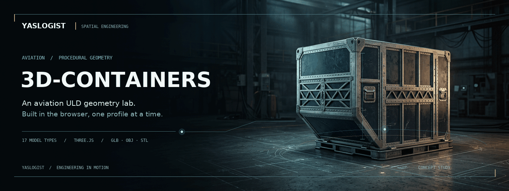
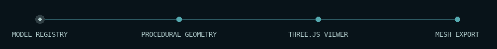
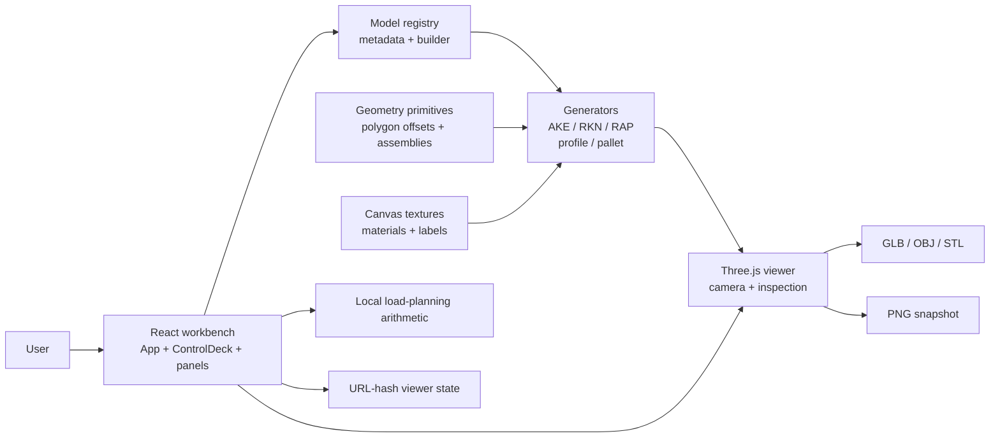

<div align="center">
  
</div>

<div align="center">
  <h1>3D-Containers</h1>
  <p><strong>Procedural aviation ULD geometry, built and explored in the browser.</strong></p>
  <p>A creative engineering project by <a href="https://www.yaslogist.com"><strong>YASLOGIST</strong></a>.</p>
  <p>
    <a href="#01--the-system">The system</a> &nbsp;·&nbsp;
    <a href="#02--the-fleet">The fleet</a> &nbsp;·&nbsp;
    <a href="#03--architecture">Architecture</a> &nbsp;·&nbsp;
    <a href="#05--ignition">Quick start</a> &nbsp;·&nbsp;
    <a href="#06--engineering-notes">Engineering notes</a>
  </p>
  <sub><a href="assets/readme/uld-cinematic-poster.png">View the static hero poster</a> · The hero is a conceptual illustration, not a dimensional rendering.</sub>
</div>

---

## `01 /` The system

**3D-Containers** is an interactive laboratory for exploring aviation unit load devices (ULDs). It generates container and pallet geometry in the browser with TypeScript and Three.js rather than loading pre-made 3D models. React provides the workbench controls; procedural Canvas textures supply finishes, placards and simulated controller displays.

| Explore | Inspect | Take away |
| :--- | :--- | :--- |
| Switch between 17 modeled ULD types; adjust finishes, doors, details and model-specific options. | Orbit, compare envelopes, cut sections, measure points and inspect dimensions or assemblies. | Export GLB, OBJ or STL meshes, save a viewport PNG, inspect source, or share viewer settings by URL. |

> **Engineering boundary** — This is a visualization and estimation tool, not a certified loading, fit or airworthiness system. Model dimensions, contours and ratings are registry values or approximations; verify against current manufacturer, airline and aircraft documentation before operational use. The hero is artwork, not one of the application's generated models.

## `02 /` The fleet

The [model registry](src/three/models.ts) binds metadata and controls to each generator. Three families have dedicated generators, eleven use the shared profile engine, and three use the shared pallet engine.

| Generator path | Modeled types | Approach |
| :--- | :--- | :--- |
| Dedicated | **AKE**, **RKN**, **RAP** | Contoured lower-deck container and two refrigerated-container representations. |
| Shared profile | **AKC**, **DPE**, **DQF**, **AQP**, **AKH**, **ALF**, **ALP**, **AAP**, **AMA**, **AMD**, **AGA** | Extruded section profiles with family-specific metadata and geometry. |
| Shared pallet | **PAG**, **PMC**, **PGA** | Parameterized pallet bases and cargo-load contours. |

<details>
<summary><strong>Reference dimensions and ratings in the model registry</strong></summary>

The following rounded values describe the configured models, not certification for a particular physical ULD. Dimensions are width × depth × height; pallet height is base thickness. Pallet volumes describe the modeled netted cargo contour.

| Model | Dimensions | Volume / tare / max gross |
| :--- | :--- | :--- |
| AKE · LD-3 | 1.53 × 1.56 × 1.62 m | 4.3 m³ (152 ft³) / Tare 92 kg · Gross 1,588 kg |
| AKC · LD-1 | 1.56 × 1.53 × 1.63 m | 4.8 m³ (170 ft³) / Tare 85 kg · Gross 1,588 kg |
| DPE · LD-2 | 1.19 × 1.53 × 1.63 m | 3.4 m³ (120 ft³) / Tare 75 kg · Gross 1,225 kg |
| DQF · LD-8 | 2.44 × 1.53 × 1.63 m | 6.9 m³ (245 ft³) / Tare 127 kg · Gross 2,449 kg |
| AQP · LD-4 | 2.44 × 1.53 × 1.63 m | 5.5 m³ (195 ft³) / Tare 120 kg · Gross 2,449 kg |
| AKH · LD3-45 | 1.53 × 1.56 × 1.14 m | 3.3 m³ (116 ft³) / Tare 82 kg · Gross 1,588 kg |
| ALF · LD6 | 3.18 × 1.53 × 1.63 m | 8.9 m³ (316 ft³) / Tare 230 kg · Gross 3,175 kg |
| ALP · LD-11 | 3.18 × 1.53 × 1.63 m | 7.2 m³ (253 ft³) / Tare 185 kg · Gross 3,176 kg |
| AAP · LD-9 | 3.18 × 2.24 × 1.63 m | 10.8 m³ (381 ft³) / Tare 270 kg · Gross 6,033 kg |
| RKN · LD-9 | 2.00 × 1.53 × 1.62 m | 3.6 m³ internal / Tare 285 kg · Gross 3,500 kg |
| RAP · LD-9 | 3.18 × 2.44 × 1.62 m | 6.6 m³ (233 ft³) / Tare 450 kg · Gross 6,033 kg |
| AMA · M-1 | 3.18 × 2.44 × 2.44 m | 17.6 m³ (621 ft³) / Tare 314 kg · Gross 6,804 kg |
| AMD · M1H | 2.44 × 3.18 × 3.00 m | 21.2 m³ (750 ft³) / Tare 370 kg · Gross 6,804 kg |
| AGA · M-2 | 2.44 × 6.06 × 2.44 m | 33.7 m³ (1,190 ft³) / Tare 1,000 kg · Gross 11,340 kg |
| PAG · P1P | 3.18 × 2.24 × 0.05 m | 11.5 m³ netted contour / Tare 110 kg · Gross 6,033 kg |
| PMC · P6P | 3.18 × 2.44 × 0.05 m | 12.6 m³ netted contour / Tare 120 kg · Gross 6,804 kg |
| PGA · 20 ft | 6.06 × 2.44 × 0.05 m | 36.0 m³ netted contour / Tare 541 kg · Gross 13,608 kg |

</details>

<details>
<summary><strong>Model notes and interpretation</strong></summary>

- AKE's contour toggle changes its geometry; profile families use their own defined sections, including rectangular, single-contour, dual-contour and roof-chamfer shapes.
- RKN and RAP include refrigeration-related details and setpoint displays. These are **simulated visual controls**, not measured temperature or connected refrigeration equipment.
- The spec sheet includes a 2D reference section and an aircraft hold-fit schematic. The latter uses a nominal floor position and simplified section; it is not a loading diagram or proof of clearance.
- The compare overlay is an envelope comparison; it does not validate contour, aircraft position, restraints or certification.
- Dimensions, ratings and specific model options are maintained in [`src/three/models.ts`](src/three/models.ts) and the corresponding generator modules. They should not be assumed to describe every real-world variant.

</details>

## `03 /` Architecture

<div align="center">
  
</div>



**Execution flow**

1. The React workbench initializes the viewer and restores any valid settings from the URL hash.
2. A registry entry selects a generator. Shared primitives build the model; Canvas-generated maps and labels supply material detail.
3. The Three.js viewer presents the scene and responds to camera, assembly and inspection controls. The planner separately computes estimates from entered cargo values and registry ratings.
4. Exporters serialize the current container group; snapshot and source-download actions create local browser downloads. Share links encode viewer settings, **not** planner cargo inputs or divisor.

<details>
<summary><strong>Procedural geometry and materials</strong></summary>

- [`primitives.ts`](src/three/primitives.ts) contains shared geometry helpers, including polygon offsetting, extruded sections and instanced rivet runs. Family generators assemble named parts used by the workbench.
- [`profileContainer.ts`](src/three/profileContainer.ts) implements the shared profile-based container path; [`pmc.ts`](src/three/pmc.ts) contains the shared pallet engine.
- [`textures.ts`](src/three/textures.ts) and [`textureSupport.ts`](src/three/textureSupport.ts) generate and cache Canvas textures. The runtime does not require external 3D model or texture files; optional web fonts are requested separately and have fallbacks.
- [`AKEViewer.ts`](src/three/AKEViewer.ts) manages the Three.js scene, camera, inspection tools, render lifecycle and mesh exporters. Scene coordinates use metres.

</details>

## `04 /` Workbench & outputs

| Capability | What it does | Important boundary |
| :--- | :--- | :--- |
| **Geometry** | Adjust finish and assembly options, animate doors or exploded views, and inspect part groups. | Controls vary by model. |
| **Inspection** | Perspective or orthographic view, dimensions, point-to-point measurement, section cuts and compare envelope. | Section clipping is view-only; exports remain whole and uncapped. |
| **Planning** | Estimate payload and volume utilization, dimensional and chargeable weight, and overload status from entered cargo. | Estimates only; aircraft position, restraint, contour and center of gravity are not evaluated. Carrier-specific charging rules and rounding may differ. |
| **Exchange** | Download binary `.glb`, `.obj`, binary `.stl`, a PNG snapshot or selected TypeScript source. | GLB exports visible objects; OBJ/STL export geometry. Check units and output in the target application. |
| **Share** | Encode viewer configuration in the URL hash. | Planner inputs are session-only and are not shared. |

## `05 /` Ignition

**Requirements:** Node.js **20.19 or newer**, npm, and a browser with JavaScript and WebGL available.

```bash
# Install exactly the dependencies in the lockfile
npm ci

# Start the Vite development server
npm run dev

# In another terminal: tests, TypeScript check and production build
npm run verify

# Serve the completed production build locally
npm run preview
```

The build writes `dist/index.html`. [`vite-plugin-singlefile`](vite.config.ts) inlines the application bundle and CSS into that file; external Google Fonts are optional, with system fallbacks. For the development server and production preview, follow the local address printed by Vite.

<details>
<summary><strong>Individual commands</strong></summary>

```bash
npm test             # Node test runner via tsx
npm run typecheck    # TypeScript, no output
npm run build        # typecheck + Vite production build
```

The repository's [CI workflow](.github/workflows/ci.yml) runs tests and build on Node 20.19 and 22, audits dependencies at the high-severity threshold, and uploads the Node 22 single-file build. CI configuration describes the checks; it is not a claim that a particular remote run passed.

</details>

## `06 /` Engineering notes

| Area | Status in this repository | Evidence / limitations |
| :--- | :--- | :--- |
| ULD geometry and inspection | Implemented | [Registry](src/three/models.ts), [generators](src/three/), [viewer](src/three/AKEViewer.ts); model details and options differ. |
| Planner and sharing | Implemented | [Planner](src/lib/planner.ts) is an estimate; [state codec](src/lib/state.ts) handles viewer settings only. |
| Automated checks | Implemented | [Tests](tests/) cover generator and geometry invariants, planning, state, UI-related logic and viewer math; they are not a substitute for an operational or browser certification. |
| Live deployment | Unverified | A [previously documented Vercel preview](https://containers-ahmedyas9966-2532s-projects.vercel.app) may exist, but its current availability has not been verified. Run locally using the commands above. |

<details>
<summary><strong>Repository map</strong></summary>

```text
src/
  App.tsx                 React workbench, state and download actions
  components/             Controls, panels and shared UI
  lib/                    Planner, share-state codec, units and downloads
  three/                  Registry, procedural generators, textures and viewer
tests/                    Automated TypeScript tests
vite.config.ts            Vite, React, Tailwind and single-file build
assets/readme/            README artwork and rendering source
```

</details>

<details>
<summary><strong>About the README artwork</strong></summary>

The hero uses a locally stored AI-generated conceptual illustration with composited typography and procedural motion. The loop and the animated flow strip are GIFs for GitHub-compatible playback; [the static poster](assets/readme/uld-cinematic-poster.png) is available for readers who prefer still imagery. The artwork can be regenerated with [`render_cinematic.py`](assets/readme/render_cinematic.py), Pillow and DejaVu fonts; this is a documentation-only tool, not an application dependency.

</details>

---

<div align="center">
  <p><strong>3D-CONTAINERS &nbsp; / &nbsp; YASLOGIST</strong></p>
  <p>Geometry made tangible. Engineering made visible.</p>
  <p><a href="https://www.yaslogist.com">www.yaslogist.com ↗</a></p>
</div>
